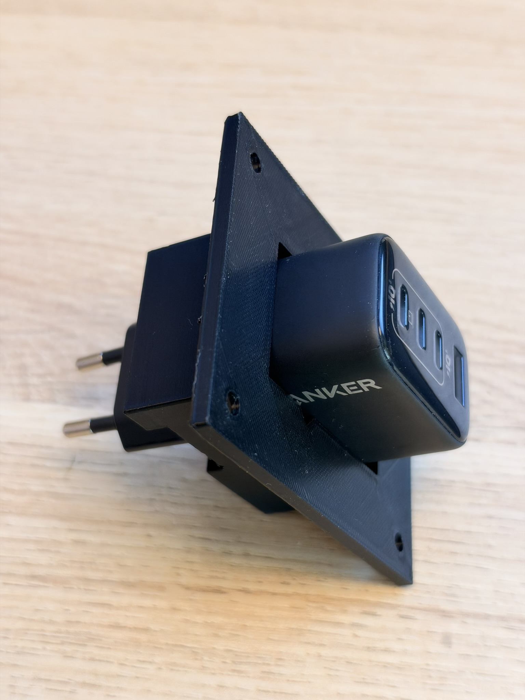
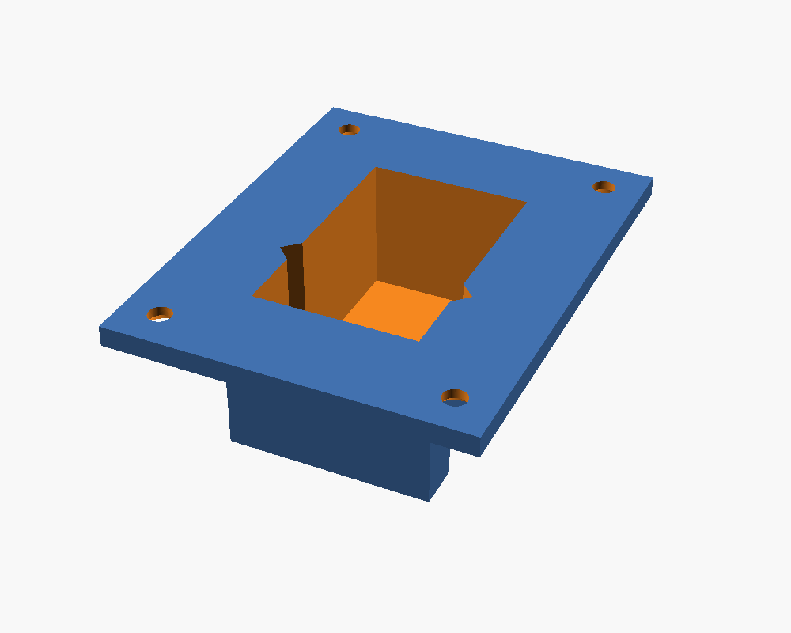
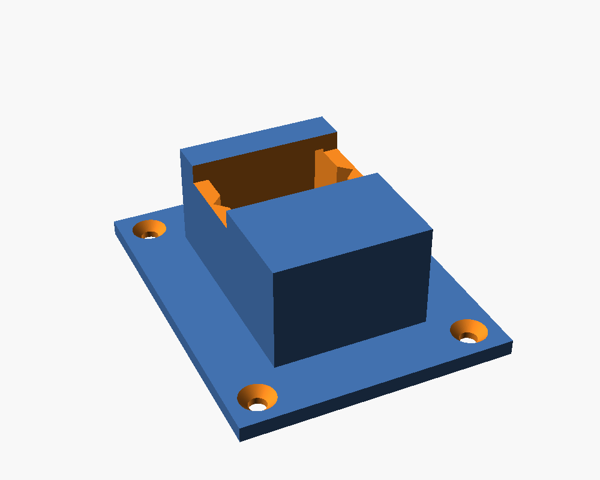
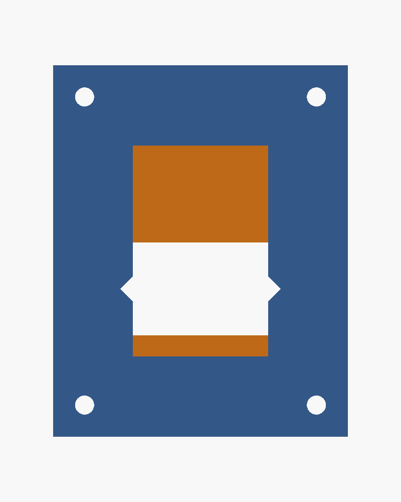

# USB Charger Holder

A parametric **flush-mount USB charger holder** for OpenSCAD: a flat mounting plate with a recessed box (pocket) underneath that holds a USB charger. A cable slot runs through the floor and both long walls, two V-grooves in the long inner walls help retain the charger, and four countersunk screw holes fix the plate in place.

> ✅ **Test print approved.** v6 has been test-printed and fits well. It was made for the charger [Anker Zolo 4-port 70W](https://www.anker.com/se/products/anker-zolo-charger-70w-4-port-pd-3-0) (Anker Zolo 70W, 4 ports).



## Previews

| Top | Bottom | Plan view |
|---|---|---|
|  |  |  |

## STL files

| File | Notes |
|---|---|
| [stl/usb_charger_holder.stl](stl/usb_charger_holder.stl) | Default parameters: plate 70 × 88 × 4 mm, pocket 32 × 50 mm, 31 mm total height |
| [stl/usb_charger_holder_anker_zolo_70w.stl](stl/usb_charger_holder_anker_zolo_70w.stl) | v6 defaults, test-printed and approved for the [Anker Zolo 4-port 70W](https://www.anker.com/se/products/anker-zolo-charger-70w-4-port-pd-3-0) |

## Parameters

All parameters are at the top of [`src/usb_charger_holder.scad`](src/usb_charger_holder.scad). Dimensions in mm.

| Parameter | Default | Meaning |
|---|---|---|
| `plate_w` | `70` | Plate width (X) |
| `plate_l` | `88` | Plate length (Y) |
| `plate_t` | `4` | Plate thickness |
| `in_w` | `32` | Inner pocket width (X) |
| `in_l` | `50` | Inner pocket length (Y) |
| `depth` | `27` | Pocket depth, from the box floor to the plate top |
| `wall` | `4` | Box wall and floor thickness |
| `slot_w` | `22` | Cable slot width (Y), through the floor and both long walls |
| `slot_h` | `5` | Cable slot height from the box bottom |
| `slot_y` | `-9` | Slot centre offset along Y from the pocket centre |
| `groove` | `true` | Add V-grooves in both long inner walls |
| `groove_w` | `6` | Groove width at the wall surface |
| `groove_d` | `3` | Groove depth into the wall |
| `groove_y` | `-9` | Groove centre offset along Y from the pocket centre |
| `screw_d` | `4.5` | Screw through-hole diameter |
| `csk_d` | `9` | 90° countersink diameter (opens on the box side of the plate) |
| `hole_inset` | `7.5` | Screw hole centre distance from the plate edges |

Total height = `depth + wall`; the box's outer size is `in_w + 2·wall` × `in_l + 2·wall`.

## Customizing in OpenSCAD

1. Install [OpenSCAD](https://openscad.org/).
2. Open `src/usb_charger_holder.scad`.
3. Edit the parameters at the top of the file, or use **Window → Customizer**.
4. Press **F6** to render, then **File → Export → Export as STL**.

From the command line:

```sh
# default holder
openscad -o holder.stl src/usb_charger_holder.scad
# shallower 17 mm pocket
openscad -o holder_17mm.stl -D depth=17 src/usb_charger_holder.scad
# larger charger, no grooves
openscad -o holder_big.stl -D in_w=40 -D in_l=60 -D groove=false src/usb_charger_holder.scad
```

## Print tips

No print settings are recorded for this design. The part has flat faces on both the plate top and the box bottom, so either can go on the bed; check overhangs (cable slot, countersinks) in your slicer.

## Open questions

- Should the screw countersinks be on the box side (as in v6) or on the other side of the plate?
